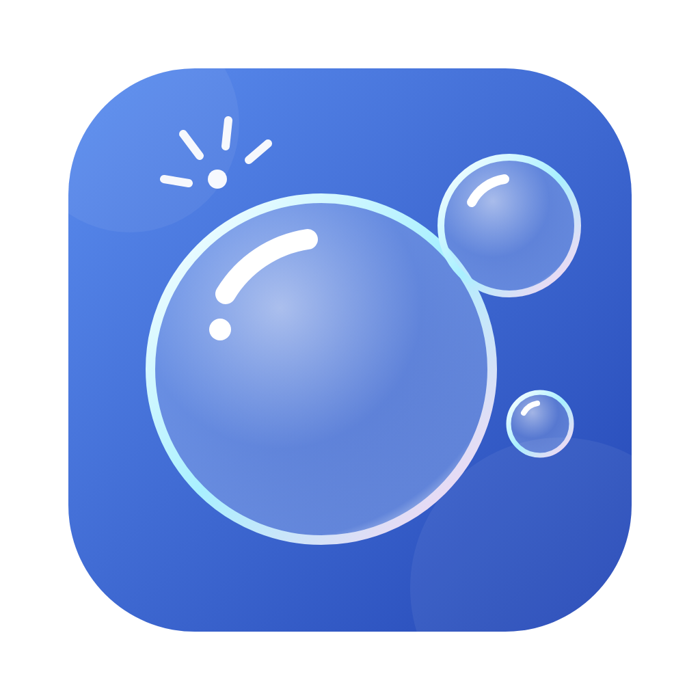

<p align="center">
  
</p>

<h1 align="center">KuaiPop（選択アシスト）</h1>

<p align="center">
  テキストを選ぶだけで、<b>翻訳・推敲・ToDo</b>。<br>
  どのアプリでも使える macOS メニューバー常駐ツール
</p>

<p align="center">
  <a href="https://github.com/ych0537/KuaiPop/releases/latest">ダウンロード</a> ·
  <a href="#必要な権限">必要な権限</a> ·
  <a href="#ソースからビルド">ソースからビルド</a>
</p>

---

## 概要

任意のアプリで文章を選択すると、すぐ近くにアイコンだけの小さなバーが表示されます。
ボタンを押すと、結果はパネルを開かずに**原文のすぐ下**に表示され、バーは自動で消えます。

| 操作 | 動き |
| --- | --- |
| 🔍 検索 | 選択したキーワードを Microsoft Teams（または Web）で検索 |
| 翻訳 | 日本語・英語 → 中国語、中国語 → 日本語。結果の「中 / 日 / EN」で言語を切り替え |
| 推敲 | ビジネス日本語に推敲（既定は社内向け・丁寧語）。入力欄なら「置き換え」で差し替え |
| ToDo に追加 | 通知なしで静かに追加。AI がタイトルと期限を抽出（「来週水曜日まで」→ 11/11（水）） |
| ToDo リスト | メニューバーのアイコンから開く。すべて / 今日 / チャットから / Web から で絞り込み |

その他の特長：

- **AI を選べる** — Mac 本体の AI（Apple Intelligence、既定）、Azure OpenAI、DeepSeek、Ollama / LM Studio、OpenAI 互換 API
- **表示言語** — 日本語 / 简体中文 / English（既定はシステムに合わせる）
- **テーマカラー** — ライトブルー / ライトグリーン / モノクロ / ラベンダー / さくら / オレンジ。ライト・ダークはシステムに追従
- **Web ページにも対応** — ブラウザで選択した内容を ToDo にすると、出典としてページタイトルと URL を記録
- **フォーカスを奪わない** — バーと結果は元のアプリの上に重ねて表示するだけで、元のアプリには書き込みません（「置き換え」を押したときを除く）

## インストール

### 2 つのバージョン

| バージョン | AI | おすすめの環境 |
| --- | --- | --- |
| **KuaiPop** | Mac 本体の AI / Azure OpenAI / DeepSeek / ローカルモデル / OpenAI 互換 | 自分の Mac |
| **KuaiPop Local** | **Mac 本体の AI（Apple Intelligence）のみ**。外部の AI サービスへの通信機能を持ちません | 会社の Mac（テキストを Mac の外に出せない環境） |

KuaiPop Local は macOS 26 以降・Apple Intelligence 対応 Mac が必要です。2 つは別アプリとして扱われるため、同じ Mac に並べてインストールできます（設定も別々）。

### 手順

1. [Releases](https://github.com/ych0537/KuaiPop/releases/latest) から次のどちらかをダウンロード
   - **`KuaiPop-<バージョン>.zip`** / **`KuaiPop-Local-<バージョン>.zip`**（おすすめ・管理者権限なし）— ダブルクリックで展開し、`KuaiPop.app` を Finder で好きなフォルダ（「書類」など）へ移動
   - `KuaiPop-<バージョン>.dmg` / `KuaiPop-Local-<バージョン>.dmg` — DMG を開き、KuaiPop を「アプリケーション」フォルダへドラッグ（管理者権限が必要な場合があります）
2. 「ダウンロード」フォルダから直接起動せず、一度 Finder で別のフォルダへ移動してから開くと、「サービス」メニューやログイン時の起動が正しく動作します
3. KuaiPop を起動し、下記の[アクセシビリティ](#必要な権限)を許可
4. メニューバーのアイコンを右クリック › **設定…** › **AI モデル** で AI を選び、「接続テスト」で確認

> ZIP・DMG とも Apple の Developer ID で署名・公証（Notarization）済みです。そのまま開けます。

**動作環境**

| 項目 | 要件 |
| --- | --- |
| macOS | 13 Ventura 以降（Apple シリコン） |
| Mac 本体の AI を使う場合 | macOS 26 以降、Apple Intelligence 対応 Mac で Apple Intelligence をオン |

## 必要な権限

KuaiPop は次の権限を使います。**すべて任意**で、権限がなくても ⌘C ×2 と「サービス」メニューで主な機能（翻訳・推敲・ToDo）を使えます。

| 権限 | 必須 | 用途 | 設定場所 |
| --- | :---: | --- | --- |
| **アクセシビリティ** | 自動表示に必要 | ほかのアプリで選択したテキストとその位置の取得、Esc キーの検知、「置き換え」時の ⌘V の送信 | システム設定 › プライバシーとセキュリティ › アクセシビリティ |
| オートメーション | 任意 | ブラウザ（Safari / Chrome / Edge / Arc / Brave など）から ToDo を作るとき、ページのタイトルと URL を取得 | 初回に確認ダイアログが表示されます（システム設定 › プライバシーとセキュリティ › オートメーション） |
| リマインダー | 任意 | ToDo の保存先に「リマインダー」を選んだときだけ使用 | 初回に確認ダイアログが表示されます |
| ネットワーク | — | 選んだ AI プロバイダーへの通信のみ。Mac 本体の AI / ローカルモデルでは外部に送信しません | 許可は不要 |
| キーチェーン | — | API キーの保存 | 許可は不要（再ビルド後は確認ダイアログが出ることがあります） |
| ログイン項目 | 任意 | 設定の「ログイン時に起動」をオンにしたとき | システム設定 › 一般 › ログイン項目 |

> **権限を付与できない場合**（会社の Mac など）
> アクセシビリティなしでも、テキストを選んで **⌘C を 2 回** 押せばバーを表示できます。右クリックの「サービス」メニューも使えます。

> **アクセシビリティが反映されないとき**
> アプリを入れ直した・再ビルドした場合は、一覧から KuaiPop を **−** で削除し、もう一度 **＋** で追加してください。

## 使い方

### バーの出し方は 2 通り

| 方法 | アクセシビリティ権限 | バーの位置 | 置き換え |
| --- | :---: | --- | :---: |
| **テキストを選択すると自動で表示**（自分の Mac 向け） | 必要 | 選択したテキストのすぐ下 | ◯ |
| **テキストを選んで ⌘C を 2 回すばやく押す**（会社の Mac など権限を付与できない環境向け） | **不要** | マウスの位置 | コピーで代用 |

⌘C ×2 はクリップボードの変化だけを見て判定するため、キー入力の監視や特別な権限は使いません。どちらも同時に有効にでき、⌘C ×2 は 設定 › 一般とショートカット でオン／オフできます。

### ショートカット（システム全体）

| キー | 動作 |
| --- | --- |
| `⌥ Space` | フローティングバーを表示 |
| `⌥ 1` | すぐに翻訳 |
| `⌥ 2` | すぐに推敲して置き換え |
| `⌥ 3` | すぐに ToDo に追加 |
| `Esc` | バー・結果を閉じる |

右クリックメニューの **サービス** からも「KuaiPop：翻訳 / 推敲 / ToDo に追加」を使えます。

### バーの出し方（設定 › 一般とショートカット）

- **選択すると自動で表示**（おすすめ・既定）
- **⌥Space を押したときだけ表示** — 自動表示が邪魔な場合
- **サービスメニューからのみ**

ターミナルや Finder など、自動表示したくないアプリは「自動表示しないアプリ」に追加できます。

### 設定画面

| ページ | 内容 |
| --- | --- |
| 一般とショートカット | バーの出し方、選択テキストの取得方法、除外アプリ、検索先、ログイン時に起動 |
| 表示と言語 | 表示言語、テーマカラー（プレビュー付き） |
| 翻訳 | 翻訳先の言語、原文がすでに翻訳先の言語のときの訳し先 |
| 推敲 | 語調：社内（丁寧語・既定）/ 社外（尊敬語・謙譲語）/ 簡潔（チャット向け） |
| ToDo | 保存先（アプリ内 / ＋リマインダー）、データの場所 |
| AI モデル | プロバイダーと接続情報、接続テスト |
| アクセス権 | 権限の状態とシステム設定へのリンク |

## AI プロバイダー

| プロバイダー | 必要な設定 | 補足 |
| --- | --- | --- |
| **Mac 本体の AI**（既定） | なし | Apple Intelligence のオンデバイスモデル。API キー不要・オフライン・データは Mac の外に出ません |
| **Azure OpenAI** | エンドポイント、デプロイ名、API バージョン（既定 `2024-10-21`）、API キー | `…/chat/completions?api-version=…` の完全な URL を貼り付けても可 |
| **DeepSeek** | API キー | モデルは `deepseek-chat` / `deepseek-reasoner` |
| **ローカルモデル** | サーバー URL（既定 `http://localhost:11434/v1`）、モデル名 | Ollama / LM Studio。「モデル一覧を取得」で選択可。`<think>` は自動で除去 |
| **OpenAI / 互換 API** | ベース URL、モデル名、API キー | — |

API キーは macOS のキーチェーンに保存され、設定ファイルには書き込まれません。

## プライバシー

- 選択したテキストは、ボタンを押したときに**選んだ AI プロバイダーにだけ**送信されます。Mac 本体の AI・ローカルモデルを選んだ場合は外部に送信されません。
- ToDo は `~/Library/Application Support/KuaiPop/todos.json` に保存されます。
- アクセシビリティで取得できないアプリでは ⌘C で選択テキストを取得し、直後にクリップボードを元に戻します（設定でオフにできます）。

## ソースからビルド

**必要なもの**：Xcode 16 以降（Mac 本体の AI を使うには Xcode 26 以降）

```bash
git clone https://github.com/ych0537/KuaiPop.git
cd KuaiPop
./scripts/build-app.sh --install                 # KuaiPop をビルド → /Applications にコピー → 起動
VARIANT=local ./scripts/build-app.sh --install   # KuaiPop Local（Mac 本体の AI のみ）
```

- スクリプトは `/Applications/Xcode.app` のツールチェーンを自動で使います（Command Line Tools だけでは SwiftUI のマクロが見つからずビルドに失敗します）。
- `--install` を付けない場合は `build/KuaiPop.app` を作成するだけです。
- `open Package.swift` で Xcode から開いてデバッグすることもできます（ただし権限は .app 単位で付与されるため、普段使いはスクリプトでのビルドがおすすめです）。

### 署名について

既定ではアドホック署名のため、再ビルドするたびにアクセシビリティの再許可が必要です。固定の証明書で署名すると、再許可は不要になります。

```bash
SIGN_IDENTITY="Developer ID Application" ./scripts/build-app.sh --install
# 証明書がない場合は「キーチェーンアクセス › 証明書アシスタント」で
# 自己署名のコード署名証明書（例: KuaiPop Dev）を作って指定してもOK
```

### 署名・公証付きの DMG を作る（配布用）

<details>
<summary>手順を表示</summary>

**事前準備（1 回だけ）**

1. developer.apple.com で最新の Apple Developer Program License Agreement に同意
2. **Developer ID Application** 証明書を作成
   Xcode › Settings › Accounts › Apple ID を選択 › Manage Certificates… › 左下「＋」› Developer ID Application
   `security find-identity -v -p codesigning` に `Developer ID Application: …` が表示されれば OK
3. account.apple.com › サインインとセキュリティ › App 用パスワード を作成し、公証用の資格情報をキーチェーンに保存
   ```bash
   xcrun notarytool store-credentials KuaiPop-notary --apple-id <Apple ID> --team-id <チーム ID>
   ```

**作成**

```bash
./scripts/release.sh            # 署名（Hardened Runtime）→ DMG 作成 → 公証 → staple → ZIP 作成 → Gatekeeper 確認
./scripts/release.sh --install  # 上記に加えて /Applications にインストール
```

両方のバージョンについて `build/KuaiPop-<バージョン>.dmg / .zip` と `build/KuaiPop-Local-<バージョン>.dmg / .zip` が作成されます。片方だけ作る場合は `VARIANTS=full` または `VARIANTS=local` を指定します。バージョンは `Resources/Info.plist` の `CFBundleShortVersionString` です。
**チーム ID の指定**（必須）— 環境変数 `TEAM_ID` か、Git 管理外の `scripts/release.env` に書きます。

```bash
echo 'TEAM_ID=<チーム ID>' > scripts/release.env     # 一度だけ。release.env はコミットされません
# または: TEAM_ID=<チーム ID> ./scripts/release.sh
```

チーム ID は developer.apple.com/account の「メンバーシップの詳細」で確認できます。資格情報名を変える場合は `NOTARY_PROFILE` も同じように指定できます。

</details>

## プロジェクト構成

```
Sources/KuaiPop/
├── App.swift               エントリーポイント（メニューバー常駐、LSUIElement）
├── AppController.swift     全体の制御：メニューバー、ToDo、設定、操作、ショートカット、サービス、Teams 検索
├── SelectionMonitor.swift  マウス・キーボードの監視（選択を検知）
├── Selection.swift         AX で選択テキストと位置を取得、⌘C フォールバック、⌘V で置き換え
├── Accessibility.swift     AX API のラッパー、座標変換
├── Overlay.swift           フローティングバーと結果表示（非アクティブ NSPanel + SwiftUI）
├── AIClient.swift          Apple / Azure OpenAI / DeepSeek / ローカル / OpenAI 互換
├── AIService.swift         翻訳・推敲・ToDo 抽出のプロンプト、言語判定
├── Todo.swift              ToDo のモデルと保存、ブラウザの URL 取得、リマインダー連携
├── TodoListView.swift      ToDo リスト UI
├── SettingsView.swift      設定画面 UI
├── L10n.swift              表示言語（日本語 / 中文 / English）
├── Theme.swift             テーマカラー
├── HotKeys.swift           グローバルショートカット（Carbon）
└── Prefs.swift / Keychain.swift
Resources/                  Info.plist、エンタイトルメント、アイコン（AppIcon.svg が原本）
scripts/                    build-app.sh（ビルド）、release.sh（署名・公証・DMG）
```

## 既知の制限

- アクセシビリティで選択範囲を公開していないアプリでは、⌘C でテキストを取得し、バーはマウスの近くに表示されます。
- 「置き換え」は ⌘V を送って実現しているため、一時的にクリップボードを使います（完了後に元に戻し、`org.nspasteboard.TransientType` を付けるのでクリップボード管理アプリには記録されません）。
- ショートカットは現在固定で、設定から変更できません。
- Teams 検索は Teams の ⌘E ショートカットを利用しています。
- 右クリックの「サービス」メニューの項目名は日本語のみです。

## ライセンス

[MIT License](LICENSE)
